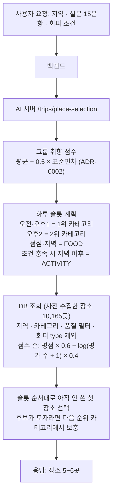
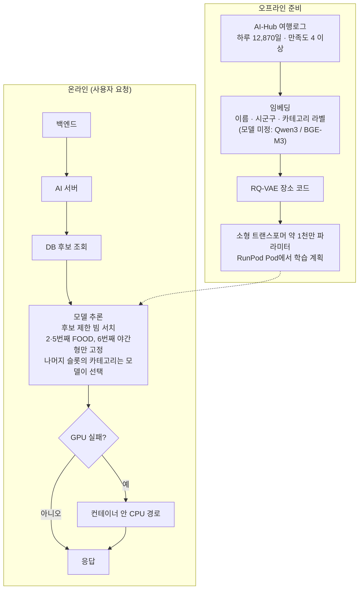
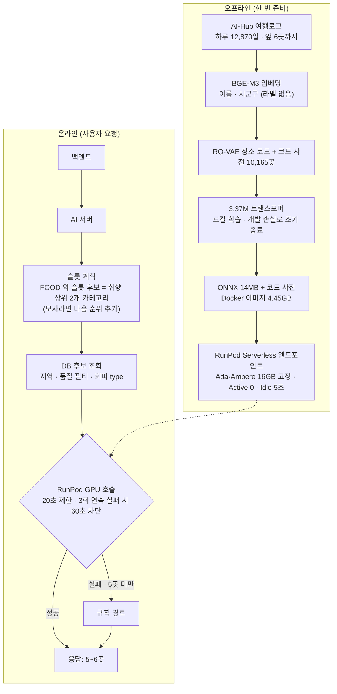

# 장소 선정 방식의 변화: 규칙 기반 → 초안 모델 → 최종 형태

작성일 2026-10-18. 이 문서는 "장소를 어떻게 고르는가"가 어떻게 바뀌었는지를 처음 보는 사람도 따라갈 수 있게 순서대로 정리한다. 근거의 원문은 `docs/adr/`의 ADR-0000, 0002~0006이고, 숫자는 모두 그 ADR과 PR #75~#83에 기록된 측정값이다.

## 0. 한눈에 보기

- 처음에는 평점과 평가 수로 점수를 매겨 슬롯마다 장소를 고르는 규칙을 썼다(ADR-0000).
- 이 규칙은 같은 입력에 늘 같은 장소를 내고, 장소 사이 거리를 보지 않으며, 실제 여행자가 간 곳과 잘 맞지 않았다.
- 그래서 실제 여행 로그로 학습한 모델이 장소를 고르게 하는 초안을 세웠다(2026-10-14, ADR-0003~0005).
- 초안은 만들고 측정하는 동안 여섯 군데가 바뀌거나 구체화되었다. 이유는 모두 측정 결과나 리뷰에서 나왔다.
- 최종 형태는 규칙의 한계 중 일부를 해결했고(동선, 학습으로 개선 가능), 일부는 해결하지 못했다(인기순과 차이 없음, 같은 입력은 같은 일정).
- 2·3안은 항상 모델 경로를 먼저 시도하고, 실패한 안만 규칙 변형으로 채운다(ADR-0010, Proposed). 이 문서를 쓴 2026-10-18에는 운영 기본값이 규칙이었고 RunPod 엔드포인트는 Max Workers 0의 일시 정지 상태(이미지 v2)였다. 지금의 엔드포인트 설정은 확인하지 못했다.

---

## 1. 규칙 기반 구조와 한계

### 1.1 설계 구조

요청에는 지역, 그룹 구성원의 취향 설문(15문항), 회피 조건이 들어 있다. AI 서버는 아래 순서로 장소를 정한다.

- 품질 필터: 영업 중, 평점 3.0 초과, 평가 수 10 이상.
- 같은 입력이면 같은 결과가 나온다(취향 점수가 동점일 때만 순서가 무작위).
- 테스트는 지역 5 × 회피 조건 부분집합 × 대표 설문 조합 7,680건으로 5~6곳, 2·5번째 FOOD, 회피 type 없음, 중복 없음을 확인한다.

### 1.2 한계

1. **같은 입력에 늘 같은 장소.** 점수 기준이 평점과 평가 수 하나뿐이라, 지역·카테고리·회피 조건이 같으면 그룹이 달라도 같은 장소가 나온다(ADR-0003 문제 정의).
2. **장소 사이 거리를 보지 않는다.** 대표 설문 24개 × 5개 지역에서 규칙이 만든 연속 장소 거리의 중앙값은 서울 7.7km, 부산 7.6km, 경주 5.9km, 전주 3.0km, 제주 25.6km였다. 실제 여행 로그에서 이어지는 방문의 중앙값은 0.9, 1.7, 1.1, 0.5, 6.0km였다.
3. **실제 여행자의 선택과 맞는지 잴 기준이 없었다.** 추천 품질의 정량 평가 기준이 없었다. 나중에 같은 기준으로 재 보니 규칙이 맞힌 비율(Recall@10)은 2.5%로, 가장 인기 있는 순으로 줄을 세운 단순 기준(5.9%)보다 낮았다.
4. **데이터로 개선할 수 없다.** 점수식과 슬롯 구조를 사람이 고쳐야 하고, 사용자 데이터가 쌓여도 추천이 나아지는 경로가 없다.
5. **앞에서 고른 장소를 보고 다음을 고르지 않는다.** 슬롯마다 독립적으로 상위 장소를 뽑는다.

---

## 2. AI 모델이 한계를 해결할 수 있다고 본 근거

아이디어는 **실제 여행자가 만족한 하루 일정(AI-Hub 국내 여행로그 12,870일)을 모델이 보고 배우게 하자**는 것이다. 모델은 "이 취향·지역에서 앞에 이런 장소를 갔으면 다음에는 이런 장소를 간다"는 패턴을 학습한다. 이 구조가 한계를 해결할 수 있다고 본 이유는 다음과 같다.

- 한계 1(같은 장소): 점수가 아니라 학습된 확률로 고르므로 입력 조합(지역, 취향)마다 다른 일정을 낼 수 있다.
- 한계 2(거리): 실제 이어진 방문을 학습하므로 가까운 장소가 이어지는 패턴을 배운다. 평가 지표에 연속 거리를 넣어 확인하기로 했다.
- 한계 3(품질 기준): 합격 기준(규칙·인기순과의 비교)을 먼저 정하고, 최종 평가용 데이터는 한 번만 열기로 했다.
- 한계 4(개선 불가): 학습 데이터와 파이프라인이 있으면 다시 학습해 개선할 수 있다.
- 한계 5(문맥): 이전 장소의 코드를 입력으로 받아 다음 장소를 고른다.

확인하지 못한 가정도 있었다. 개인 여행자의 취향으로 학습한 모델이 그룹 점수(그룹의 취향 상위 2개 카테고리)를 입력해도 동작한다는 점은 데이터에 그룹 취향 정보가 없어 직접 검증할 수 없었다.

---

## 3. 초안 모델 (2026-10-14, ADR-0003·0004·0005 최초 버전)

초안의 핵심은 두 가지였다.

- **장소를 코드로 바꾼다(Semantic ID).** 장소 이름·시군구·카테고리 라벨을 임베딩(문장을 숫자 벡터로 바꾸는 모델)한 뒤 RQ-VAE로 3단계 코드(각 256종)를 붙인다. 모델은 장소 이름이 아니라 이 코드를 생성한다. 로그의 방문지와 DB 장소의 ID 대응이 17.5~34%에 그쳐서 ID 임베딩 방식은 쓸 수 없었다.
- **후보 안에서만 고르게 한다.** 모델이 낸 확률 중 후보 목록(지역, 회피 조건, 품질 하한, 이미 쓴 장소, 2·5번째 FOOD, 6번째 야간형)에 있는 코드만 고르는 결정론 빔 서치로 슬롯을 채운다. 그래서 후보 밖의 장소나 존재하지 않는 장소는 나올 수 없다.

- 서빙은 RunPod Serverless GPU 우선, 실패하면 AI 서버 컨테이너의 CPU 경로로 되돌리는 구상이었다(ADR-0004).
- 평가는 지표 5개를 보고, 최종 평가용 일수가 지역별 100일 미만이면 판정을 보류하는 방식이었다(ADR-0005).

---

## 4. 초안에서 바뀐 부분과 이유

여섯 묶음으로 정리한다. 각각 "무엇이 → 무엇으로", 그리고 이유다.

### 4.1 장소를 코드로 바꾸는 방법

- **카테고리 라벨을 텍스트에서 뺐다.** 정답 쌍의 32%에서 한쪽에만 라벨이 있거나 구성이 달라서, 같은 장소인데도 코드 일치율이 1~4%였다. 라벨을 빼면 같은 방문 기준 첫 코드 일치율이 78.3%에서 93.0%(BGE-M3)로 올랐다. 카테고리는 후보 제한 때 DB 값을 쓰면 된다.
- **임베딩 모델은 BGE-M3(MIT, 1024차원)로 확정했다.** Qwen3-Embedding-0.6B와 비교해 첫 코드 일치율 93.0% 대 90.7%로 같거나 약간 앞서고 계산이 빨랐다. 차이는 작아 확정적인 우위는 아니다.

### 4.2 학습 데이터와 모델 크기

- **로그의 하루를 앞 6곳까지만 쓴다.** 로그의 하루는 최대 23곳인데 서비스는 5~6곳을 만들어서, 서비스와 같은 길이로 맞췄다.
- **모델 크기는 추정에서 실측 비교로 정해졌다.** 초안은 "소형 트랜스포머를 처음부터 학습, 약 1,000만 파라미터대로 추정(실측 전)"이었다. 추정 크기에 가까운 모델(약 1,096만, 차원 384·6층)과 더 작은 모델(약 337만, 차원 256·4층)을 같은 데이터로 모두 학습해 개발용 손실로 비교했고, 작은 모델(손실 1.8154)이 큰 모델(1.8309)보다 낮아 채택했다. 큰 모델은 학습 손실만 계속 내려가고 개발 손실은 더 일찍 올라, 학습 데이터가 작아 더 빨리 외운 것으로 보인다. 모델 종류(사전학습 없이 처음부터 학습하는 소형 트랜스포머)와 입력은 그대로이고 크기만 정해졌다. 선택 근거는 개발 손실뿐이며 큰 모델은 Recall@10으로 평가하지 않았다(손실 차이는 약 0.8%로 작다).
- **학습은 RunPod Pod 대신 로컬 Mac에서 했다.** 에폭당 약 5초라 Pod가 필요 없었다.

### 4.3 평가 기준

- **합격 지표는 하나로 줄였다.** 지표가 여러 개면 결과를 본 뒤 좋은 것을 고르게 되므로 Recall@10(정답 장소가 추천 상위 10곳 안에 있는 비율)만 합격에 쓰고 나머지는 보고용으로 돌렸다.
- **분모는 필터와 무관한 모든 정답 방문으로 했다.** DB 장소에 대응된 만족 방문 중 28.4%가 품질 필터(평점·평가 수)에 막혔다. 그 방문을 빼면 필터의 비용이 보이지 않는다.
- **"100일 미만 보류" 대신 표준 비열세 검정으로 바꿨다.** 처음에는 "신뢰구간 폭이 마진의 2배 이하인 지역만 판정"으로 정했는데, 규칙 기준선이 2.4%로 작아 마진이 0.245%p가 되면서 5개 지역이 모두 보류되는 판정 불능이 되었다. 지금은 신뢰구간이 −마진을 넘으면 통과, −마진을 걸치면 보류, 그 아래면 불합격이다.
- **지역별로 모델과 규칙을 나눠 쓰는 도입은 허용하지 않았다(전부 아니면 전무).**

### 4.4 평가 조건을 서비스와 맞춘 것 (가장 큰 변경)

- 처음 평가는 모델이 지역 전체 후보에서 순위를 매겼고(Recall@10 13.8%), 서비스는 그 조건이 아니었다. PR #78 리뷰에서 이 차이가 지적되었다.
- 조건별로 다시 재서 다음을 확인했다(개발용, 규칙 2.4%, 인기순 5.5%).
  - 제약 없음 13.4%
  - FOOD 슬롯만 제한(초안과 같은 조건) 9.3%. 그러나 FOOD 외 추천의 절반만 사용자가 고른 취향 카테고리에 맞았다(50.0%).
  - 규칙의 슬롯 카테고리를 그대로 고정 4.2%(인기순보다 낮음)
  - **FOOD 외 슬롯을 취향 상위 두 카테고리로 제한 5.9%** (채택, 취향 일치 99.9%)
- 후보 7,680건 조합을 모델 경로만 직접 호출해 확인하다가, 회피 조건 때문에 상위 두 카테고리의 후보가 사라지면 장소가 2곳만 나오는 문제를 발견했다. 규칙의 보충 방식처럼 다음 순위 카테고리를 더하도록 고쳤다.

### 4.5 서빙 구조

- **GPU 종류를 고정했다.** 같은 이미지에서 최신 세대 GPU는 첫 요청이 43~48초, RTX A4500은 8.8초 걸렸다. 최신 세대용 코드가 이미지(CUDA 12.4)에 없어 첫 사용 때 컴파일된 것으로 추정한다(직접 확인하지 못함). 엔드포인트를 구세대(Ada·Ampere) 16GB 그룹으로 고정했다.
- **이미지와 핸들러 오류 두 가지를 로컬 빌드에서 잡았다.** 없는 `onnxruntime-gpu` 버전 지정, GPU 장치가 없을 때 CUDA를 요청하면 폴백하지 않고 죽는 문제(장치가 보일 때만 CUDA 요청).
- **AWS 서버에는 CPU 경로를 배포하지 않기로 했다.** 그래서 실제 폴백 순서는 "GPU → 규칙"이다(코드는 남겨 둠).
- **기본 경로는 GPU 우선으로 정했다.** 측정에서는 CPU 추론(서울 276ms)이 GPU 경로(총 1.3초)보다 빨랐다. 그래도 GPU 서빙 경험이라는 프로젝트 목표를 우선했다. CPU 우선과 Idle timeout 연장은 대안으로 기록했다.

### 4.6 관측과 운영

- 정상 요청의 경로 로그가 서버 로그에 나오지 않는 한계를 확인했고(INFO 레벨), 응답에 영향이 없어 후순위로 미뤘다.
- 최종용 데이터는 한 번만 열기로 해서 서비스 조건으로 다시 열지 않았다. 그 사실은 ADR-0006에 적었다.

---

## 5. 최종 형태

- 모델 경로가 실패하거나 5곳 미만이면 사용자는 규칙 경로의 결과를 받는다. 응답은 항상 만들어진다.
- 모델 경로에 필요한 환경변수는 `RUNPOD_MODEL_URL`, `RUNPOD_MODEL_API_KEY`이고 `MODEL_DIR`은 비운다. 2·3안은 항상 모델 경로를 먼저 시도한다(ADR-0010, 이전의 `PLACE_SELECTION_MODE`는 제거됨).

---

## 6. 최종 형태는 규칙 기반의 한계를 극복했는가

한계별로 판정한다.

- **한계 1, 같은 입력에 같은 장소: 부분적으로 해결.** 개발용 311일을 서비스처럼 생성했을 때 서로 다른 장소가 규칙 48곳에서 83곳으로 늘었고, 가장 많이 나온 상위 1% 장소의 점유가 11.4%에서 6.4%로 줄었다. 입력이 지역과 취향 4비트뿐이라 모델 1위만 쓰면 같은 입력에 항상 같은 일정이 나온다. 이를 줄이려고 ADR-0007에서 첫 장소를 모델 상위 30곳 중 요청 해시 시드로 무작위 선택하게 했다. 같은 요청은 같은 결과, 요청이 다르면 다른 첫 장소가 나온다(개발용 비교에서 서로 다른 장소 수 3.4배, 입력 57건·대리 지표만 확인, GPU에서 시드 1 두 번 동일·시드 2 다름 확인).
- **한계 2, 거리: 해결.** 연속 장소 거리의 중앙값이 규칙 13.7km에서 모델 4.9km로 줄었다(같은 개발용 일정, 5개 지역 합산).
- **한계 3, 품질 기준: 기준은 생겼고 결과는 절반의 성공.**
  - 최종용 평가(슬롯 제약 없음)에서 모델 13.8%, 인기순 5.9%, 규칙 2.5%로 5개 지역 모두 통과했다.
  - 서비스 조건(개발용)에서는 모델 5.9%, 규칙 2.4%로 규칙보다 +3.5%p 높지만 인기순(5.5%)과는 +0.4%p(−0.3~+1.2)로 차이가 없다.
  - 규칙은 실제 행동과 어긋나는 약한 기준선이라, 규칙을 이긴 것을 크게 해석하면 안 된다.
- **한계 4, 개선 불가: 해결.** 학습 데이터와 파이프라인, 평가 기준, 산출물 해시 관리가 있어 다시 학습하고 같은 기준으로 비교할 수 있다.
- **한계 5, 앞 장소를 보지 않음: 해결(구조).** 이전 장소의 코드를 입력으로 받는다.

**새로 생기거나 남은 문제**

- 학습 정답에 공항·항구·광역 지명("제주도")이 섞여 있어 모델이 공항 전망대 같은 장소를 추천하는 사례가 있다.
- 응답이 느려진다. 따뜻한 상태 총 약 1.3초, 한동안 요청이 없다가 오는 첫 요청 약 10~13초(규칙은 약 0.2초).
- GPU 비용과 장애 위험이 생긴다. 장애 때는 규칙으로 돌아가므로 추천 품질이 규칙 수준이 된다.
- 최종용 평가는 서비스 조건이 아닌 조건에서 한 번 열었고, 서비스 조건은 개발용에서만 확인했다.

---

## 7. 사용자가 겪는 경험

같은 서울 요청(대표 설문 1건)에서 두 방식의 일정은 다음과 같다. 순서는 오전, 점심, 오후1, 오후2, 저녁이다.

- 규칙: 경복궁 → 핏제리아오 대학로본점 → 국립중앙박물관 → 여의도한강공원 → 명동교자 본점
- 모델(GPU): 김포공항 국내선 공항전망대 → 스타벅스 김포공항DT점 → 여의도한강공원 → 마포아트센터 → BHC 홍대점

이 예시는 장단점을 함께 보여 준다. 모델 일정은 앞뒤 장소가 가깝게 묶이지만, 첫 장소가 공항 전망대인 점이 어색하다. 규칙 일정은 익숙한 관광지가 나오지만 장소 사이를 오가는 거리는 신경 쓰지 않는다.

- **정상일 때(모델 켬):** 취향에 맞는 카테고리 안에서 장소가 이어지고, 같은 요청이면 같은 결과를 받고, 요청 내용이 달라지면 첫 장소가 달라질 수 있다(ADR-0007). 응답은 요청이 이어질 때 약 1.3초, 한동안 요청이 없다가 오면 약 10~13초 걸린다.
- **GPU가 실패할 때:** GPU가 곧바로 오류를 내면 규칙 경로의 결과를 약 1초 안에 받는다. 응답이 아예 없으면 20초를 기다린 뒤에 규칙 결과를 받으므로 그만큼 늦다(이 20초 대기는 실제 타임아웃으로는 시험하지 않았다). 어느 쪽이든 사용자는 오류 없이 일정을 받지만 장소 선택은 규칙 수준이다. 연속 3번 실패하면 60초 동안 GPU를 부르지 않는다.
- **운영에서는:** 2·3안은 모델 경로를 먼저 시도하므로 서버에 `RUNPOD_MODEL_URL`과 키가 있고 엔드포인트가 응답하면 위 경험이 시작된다(ADR-0010). 엔드포인트가 일시 정지(Max Workers 0)이거나 설정이 없으면 규칙 변형 결과를 받는다. 이 문서를 쓴 2026-10-18에는 엔드포인트가 Max Workers 0의 일시 정지 상태(이미지 v2)였고, 지금 값은 확인하지 못했다.

---

## 부록

**용어**

- Recall@10: 추천 상위 10곳 안에 실제 정답 장소가 들어 있는 비율.
- 비열세 검정: 새 방법이 기준 방법보다 나쁘지 않은지(마진 안인지)를 신뢰구간으로 판정하는 방식.
- 콜드 스타트: 요청이 없어 워커(서버리스 컨테이너)가 내려가 있다가 첫 요청으로 다시 뜨는 데 걸리는 시간.
- 서킷 브레이커: 호출이 연속으로 실패하면 일정 시간 그 경로를 아예 부르지 않는 장치.
- Semantic ID: 장소를 이름이 아니라 의미 기반의 짧은 코드열로 표현한 것.

**근거 문서**

- ADR-0000(규칙, Superseded), ADR-0002(그룹 점수), ADR-0003(모델 구조), ADR-0004(서빙), ADR-0005(학습·평가), ADR-0006(슬롯 후보 제한), ADR-0007(첫 장소 상위 30곳 중 시드 무작위).
- 인계 요약: `.grill/handoff-semantic-id.md`. 관련 PR: #75, #76, #78, #82, #83.
- 학습·평가 산출물은 여행자 ID와 좌표가 있어 레포 밖 `$AIHUB_ROOT/derived/semantic_id/v1`에 있다.
